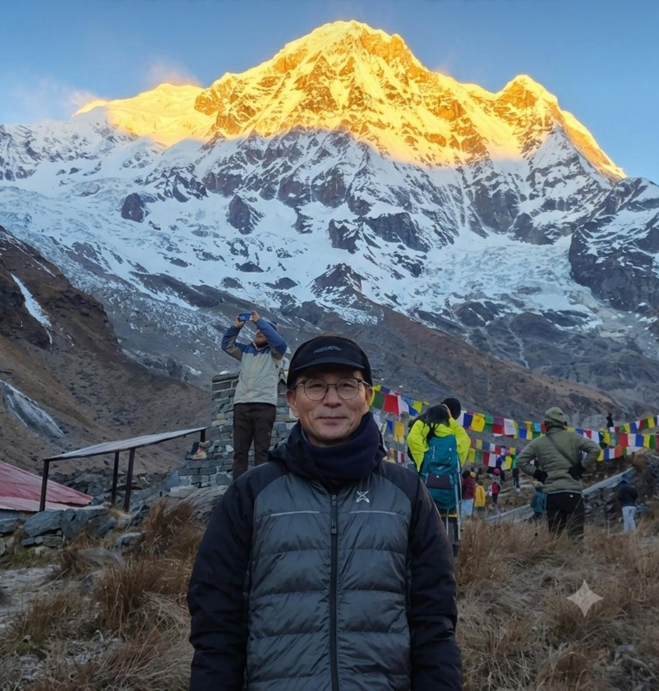

히말라야 ABC 트레킹(12일 완주) 종합 안내서 및 포토앨범 세부 구조

#### 1. 여행 기본 정보 및 일정표

여행 기본 정보: 상품명, 일정, 가격, 항공 및 인원 핵심 상세 일정표: 1~2일차: 인천~카트만두, 포카라 보팅 및 전망대 3~4일차: 나야폴 출발 ~ 푼힐 일출 ~ 타다파니 5~6일차: 촘롱 ~ 시누와 ~ 데우랄리(금욕구간) 7일차: MBC 경유 ~ ABC(4,130m) 최종 도착 8~9일차: ABC 일출 후 하산, 지누단다 온천 10~12일차: 마트큐 지프 이동, 포카라·카트만두 관광 및 귀 국

#### 2. 비용 정보 및 행정 안내

비용 및 포함·불포함: 포함내역, 비자비/팁, 싱글룸 비용, 계좌 정보 취소 수수료 규정: 국외여행 특별약관 시점별 요율 적용 입국 및 장비 관리: 비자 발급 및 카고백(15kg) 패킹 가이드

#### 3. 현지 생활, 식사 및 안전 가이드

식사·환전: 전속 한식팀 메뉴, 안전 식수, 루피 소액권 확보 히말라야 13대 유의사항: 고산증 예방('비스따리'), 샤워 금지, 야크 대피 여행자 보험: 삼성화재 상해·질병 및 해외 의료비 담보

#### 4. 준비물 체크리스트 및 난이도 분석

필수 준비물: 우모복, 고어텍스 자켓, 중등산화, 스틱, 아이젠 등 최고 난이도 코스: 고라파니 오르막 및 데우랄리~ABC 구간 난이도 유발 요인: 희박한 산소, 끝없는 돌계단, 극한 추위

#### 5. 히말라야 트레킹 포토앨범

제1장: 여정의 시작 - 포카라와 하늘길 (Buddha Air 탑승) 제2장: 평화로운 여백 - 페와 호수와 사원, 푼힐 전망대 제3장: 정상을 향하여 - ABC 설산 단체 촬영, 마차푸차레 제4장: 산길 위 정과 휴식 - 촘롱 빵집, 로지의 밤 제5장: 도전의 결실 - 완주 기념 패 수여식, 해단식 만찬

#### 부록: 주요 거점 위성 지도 및 경로 가이드

인천-카트만두-포카라 광역 이동 루트 고레파니 푼힐 전망대 위성 지도 마트큐-지누단다 ABC 트레킹 시작점 가이드 ABC 상추어리 및 지누단다 노천 온천 가이드

# 네팔 안나푸르나 히말라야 트레킹 완벽 통합 안내서

푼힐 & 안나푸르나 베이스캠프(A.B.C) 12일 실전 가이드북

## 1. 여행 기본 정보

상품명: [안나푸르나] 푼힐/베이스캠프 트레킹 12일 여행사: 혜초여행사 일정: 2026년 10월 10일(토) ~ 10월 21일(수) [10박 12일] 항공: 대한항공 이용

가격: 성인 1인 4,100,000원 (유류할증료 포함) 인원: 최소 8명 출발 (15명 이상 한국인 인솔자 동행)

코스 요약: 인천 ➔ 카트만두 ➔ 포카라 ➔ 안나푸르나 트레킹(7일) ➔ 포카라 ➔ 카트만두 ➔ 인천

## 2. 핵심 상세 일정표 (실전 일시 및 숙소·식사)

| 일차 날짜/요일 주요 상세 일정 숙박 비고                                          | 및 식사    |
|------------------------------------------------------------------|---------|
| 1일차 10/10 (토) 인천 출발 ➔ 카트만두 도착 후 숙소 이동 5성급 호텔                     |         |
| 시차                                                               | -3시간 15 |
| 비자/장비                                                            | 수령      |
| 2일차 10/11 (일) 카트만두 ➔ 포카라 (국내선 30분) ➔ 페와 호수 보팅 ➔                  |         |
| PUMDI 사원/전망대 관람                                                  |         |
| 피쉬테일 롯지                                                          |         |
| (Fish Tail)                                                      |         |
| 점심:                                                              | 치킨      |
| 저녁:                                                              | 생선구이    |
| 3일차 10/12 (월) 포카라 ➔ 나야폴/비레탄티 (버스2h + 지프1h)                       |         |
| ➔ 7시간 20분 산행 (12.3km, 고도 1,000m 상승) ➔ 18:20 고                    |         |
| 라파니 도착                                                           |         |
| 고라파니 롯지 트레킹                                                      | 1일차     |
| 4일차 10/13 (화) 04:30 고라파니 출발 ➔ 05:30 푼힐전망대 일출 조망                  |         |
| ➔ 07:00 복귀/조식 ➔ 08:00 출발 (7km) ➔ 14:40 타다파니                      |         |
| Hotel Super view                                                 |         |
| 트레킹                                                              | 2일차     |
| 조:롯지                                                             | / 중:현   |
| 5일차 10/14 (수) 07:00 타다파니 출발 (7km) ➔ 12:00 촘롱 점심 및 1시간 휴식         |         |
| ➔ 13:20 출발 (2시간 산행) ➔ 15:20 시누와 도착                               |         |
| KALPANA Guest                                                    |         |
| 트레킹                                                              | 3일차     |
| 중:                                                               | 촘롱 칼국수  |
| 6일차 10/15 (목) 07:00 Lower Sinuwa 출발 ➔ 08:00 Upper 시누와 ➔ 09:50 밤  |         |
| 부 ➔ 11:30 도반 점심 ➔ 히말라야 휴식 ➔ 16:30 데우랄리 도                         |         |
| 데우랄리 Shangrila                                                   |         |
| Guest House                                                      |         |
| 트레킹                                                              | 4일차     |
| 7일차 10/16 (금) 08:00 데우랄리 출발 ➔ 10:50 M.B.C 도착 (3,700m)            |         |
| ➔ 12:30 M.B.C 출발 ➔ 14:30 A.B.C 최종 도착 (4,130m)                    |         |
| A.B.C 롯지                                                         |         |
| 트레킹                                                              | 5일차     |
| 극동계                                                              | 방한복     |
| 8일차 10/17 (토) A.B.C 일출 ➔ 08:00 A.B.C 출발 ➔ 09:30 M.B.C 통과 ➔ 11:10 |         |
| 데우랄리 점심 ➔ 13:50 히말라야 휴식 ➔ 15:30 도반 도착                            |         |
| 도반 롯지 트레킹                                                        | 6일차     |
| 하산,                                                              | 무릎보호    |
| 9일차 10/18 (일) 07:00 도반 출발 ➔ 밤부/시누와 ➔ 11:30 촘롱 점심 ➔ 13:30         |         |
| 출발 ➔ 15:30 지누단다 도착 및 온천욕                                         |         |
| 지누단다 롯지 트레킹                                                      | 7일차     |
| 석:                                                               | 염소수육 해  |
| 10일차 10/19 (월) 07:00 지누단다 출발 ➔ 지프 1.5h ➔ 나야폴 ➔ 09:20 버스 ➔        |         |
| 포카라 점심 ➔ 국내선 이동 ➔ 카트만두 도착                                        |         |
| 5성급 호텔 석:                                                        | 돼지두루치   |
| 대여장비                                                             | 반납      |
| 11일차 10/20 (화) 오전: 카트만두 왕궁 관광 ➔ 오후: 타멜거리 쇼핑 후 공항 이동              |         |
| 및 밤 비행기 귀국                                                       |         |
| 기내박 중:                                                           | 인도식 카레  |
| 12일차 10/21 (수) 04:30 인천국제공항 도착 및 입국 수속 후 해산 귀국                   | 서비스 종   |

포함 사항: 왕복/국내선 항공료, TAX, 전 일정 숙박 및 식사(한식 요리팀 동행), 전용 차량, 여행자 보험, 우의 무료 대여

현지 필수 지불 (불포함 현금): 가이드/기사 팁 USD 120, 네팔 비자비 USD 30 (소액 신권 준비)

선택 비용: 싱글룸 추가 420,000원 (호텔 3박 + 롯지 3박만 적용 가능 / 시누와 이후 다인실)

계약금: 1인당 500,000원 (신한은행 100-031-542515 / 예금주: 혜초여행개발(주))

### 국외여행 특별약관 취소 수수료 규정

※ 항공권 발권 이후 취소 시 상기 취소 수수료 외에 항공사 취소 수수료가 추가 부과됩니다.

| 취소 시점            | 수수료율      | 취소 시점          | 수수료율      |
|------------------|-----------|----------------|-----------|
| 출발 31일 전까지       | 여행요금의 5%  | 출발 9일 ~ 8일 전까지 | 여행요금의 20% |
| 출발 30일 ~ 20일 전까지 | 여행요금의 10% | 출발 7일 ~ 1일 전까지 | 여행요금의 30% |
| 출발 19일 ~ 10일 전까지 | 여행요금의 15% | 출발 당일 취소 통보 시  | 여행요금의 50% |

## 4. 공항 입국 & 비자 발급 및 대여 장비 관리

- 1. 비자비 수납: 2층 도착층 'WITHOUT VISA' 카운터 창구에서 여권, 신청서, \$30 제출 후 영수증 수령 (거스름돈 없음).
- 2. 입국심사: 영수증, 여권, 보딩패스 제출. (1일차 숙박 호텔명 '하얏트' 또는 '센트럴' 숙지)
- 3. 장비 수령 & 패킹: 카트만두 호텔 도착 후 OT에서 카고백/침낭 지급. 포터용 카고백 (15kg 제한): 트레킹 용품 및 대여 침낭(약 2kg) 패킹. 순수 짐은 13kg 이내. 호텔 보관용 캐리어: 트레킹 미사용 도시 의류 및 캐리어는 카트만두 호텔에 보관. 개인 배낭 (30~40L): 산행 중 필요한 여권, 보조배터리, 바람막이, 랜턴, 물통, 약품 직소지.

## 5. 트레킹 식사 및 보조배터리 / 환전 가이드

��️ 한식 식사 시스템: 전속 한식 요리팀이 고산 압력솥과 양념을 지참하여 전 일정 동행.

• 조식: 누룽지, 쌀밥, 국(북어/미역/무국), 계란후라이, 김치, 장아찌 • 중식: 수제비, 칼국수, 비빔밥, 떡볶이, 김치볶음밥 등 한그릇 요리 및 차 • 석식: 닭볶음탕, 돼지불고기, 백숙, 제육볶음 및 찌개류 (지누단다 하산 시 염소수육 파티 특식 제공) •식수: 매일 100도 이상 끓여서 식힌 안전한 식수를 무상 제공 (개인 보온병 지참)

�� 보조배터리 & �� 환전 관리:

• 배터리 항공 규정: 기내 소지 필수(위탁 불가, 1인당 최대 2개). 절연 테이프 부착 권장. • 보관 팁: 추위 속 방전 방지를 위해 낮에는 자켓 안주머니, 밤에는 수건에 감싸 침낭 속 투입. • 환전 팁: 비자비 \$30 및 가이드 팁 \$120 준비. 현지 비용은 카트만두 타멜거리 환전소에서 \$50/\$100 고액권으 로 루피(NPR) 환전. 롯지 이용을 위해 100/500루피 소액권 다량 확보 필수.

- 1. 고산증 예방: '비스따리(천천히)' 이동. 증세 악화 시 가이드 지시에 따라 즉시 하산.
- 2. 의약품 지참: 다이아막스, 비아그라 등 처방 약품은 출국 전 전문의 상의 후 지참.
- 3. 조기 하산: 개인 사정으로 조기 하산 시 발생하는 추가 체류 비용은 본인 부담.
- 4. 롯지 환경: 시누와 이후 다인실 투숙 고정, 야간 소음 주의. 와이파이/충전/온수샤워는 현금 유료.
- 5. 체온 유지 & 샤워 금지 (★최고 중요): 도반/데우랄리/ABC 구간은 샤워, 머리감기, 세수 금지 (물티슈 사용). 휴식 시 즉시 헤비패 딩 착용. . 안전 관리: 대열 이탈 금지, 개인 지병 약 철저 준비, 승마 및 오토바이 탑승 금지.
- 7. 가축 무리 조우 시 (★추락 주의): 야크, 소, 나귀 무리를 만나면 즉시 산행을 멈추고 \*\*'길 안쪽(산비탈/벽 쪽)'\*\*으로 붙어 대피.

## 7. �� 여행자 보험 담보 한도 요약 (삼성화재)

| 담보   | 항목            | 1~14세   | 15~69세  | 70~79세  | 80~99세   |
|------|---------------|---------|---------|---------|----------|
| 상해   | 사망            | 없음      | 없음      | 1억원     | 없음       |
| 상해   | 후유장해          | 1억원     | 1억원     | 1억원     | 없음       |
| 질병   | 사망 및 고도후유장해   | 없음      | 1,500만원 | 1,000만원 | 없음       |
| 해외   | 의료비 (상해/질병)   | 500만원   | 1,000만원 | 500만원   | 질병 300만원 |
| 배상책임 | (자기부담 1만원)    | 1,000만원 | 2,000만원 | 1,000만원 | 200만원    |
| 휴대품  | 손해 (자기부담 1만원) | 30만원    | 50만원    | 30만원    | 없음       |

※ 휴대품 손해는 물품 1개당 최대 20만원 한도. 도난 시 경찰 사고증명서(Police Report) 원본 필수.

## 8. �� 트레킹 필수 준비물 체크리스트

### 의류 및 보온 용품

속건성 긴팔 등산 셔츠 춘추/동계 등산바지 (2벌 이상) 플리스 자켓 & 경량 패딩 고어텍스 방수·방풍 자켓 및 바지 헤비 우모복/다운패딩 (ABC 필수) 기능성 타이즈/보온 내복

### 등산 전문 장비

중등산화 (미리 길들인 신발) 개인 배낭 (30~40L, 레인커버) 등산 스틱 1쌍 & 무릎 보호대 판초우의 & 오염 방지 스패츠 헤드랜턴 (여분 배터리 지참) 아이젠 (적설 대비)

#### 잡화, 세면 및 상비약

울 양말, 춘추/방한 장갑 챙모자, 털모자, 선글라스, 버프 세면도구, 스포츠 타올 물티슈 다량, 두루마리 휴지 먼지 마스크 (지프 이동 시 필수) 1L 보온병 / BPA Free 물통 고자외선 선크림 & 립밤 상비약, 개인 행동식 (초콜릿 등)

# 안나푸르나를 향한 여정

히말라야의 장엄한 순백 설산과 대자연 속 동행의 기록

가슴 속 깊이 품어왔던 신들의 정원, 네팔 안나푸르나(Annapurna)로 떠난 여정. 하늘과 가장 가까운 곳에서 거 대한 설산을 마주하고, 서로의 발걸음을 응원하며 걸었던 순간 순간의 기억을 포토앨범으로 담았습니다.

## 제1장: 여정의 시작 – 포카라와 하늘길

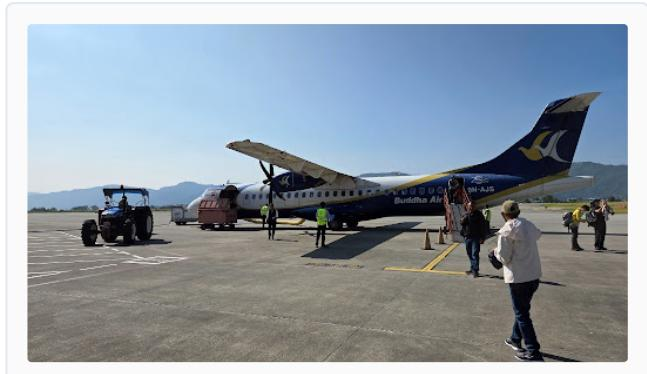

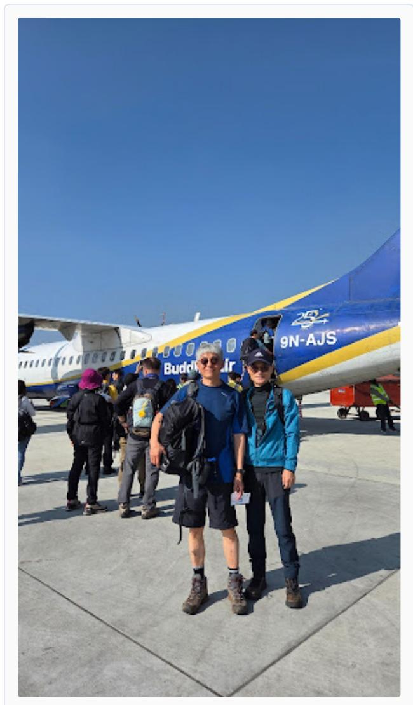

하늘길을 앞두고 다진 결의

네팔 카트만두/포카라 공항의 파란 하늘 아래, 도전을 앞둔 대원들이 한자리에 모여 힘찬 출발을 다짐했습 니다. 설레는 마음과 약간의 긴장감이 공존하던 순간 입니다.

Buddha Air 탑승 전

포카라로 향하는 경비행기(Buddha Air)를 배경으로 다정한 포즈를 취했습니다. 맑은 날씨 속에 트래킹의 시작을 알리는 경쾌한 발걸음이 이어졌습니다.

## 제2장: 평화로운 여백 – 페와 호수와 사원

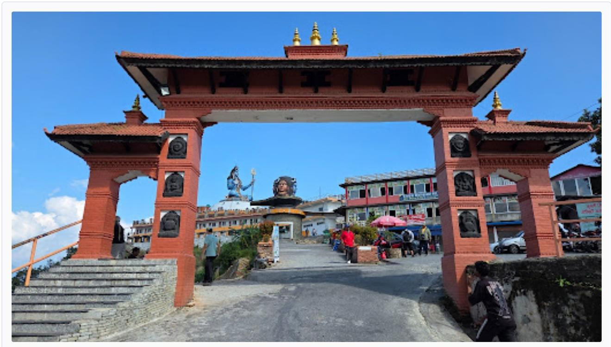

## 페와 호수(Phewa Lake)에서의 유유자적한 보팅

잔잔한 물결 위로 잔구름과 산세가 반사되는 페와 호수에서 붉은색 나룻배에 몸을 실었습니다. 본격적인 산행 전, 마음의 평온을 찾고 포카라의 풍경을 만끽한 휴식의 시간이었습니다.

## 시바 신상 문

## 상징적인 힌두 사원 문과 시바 신상

웅장한 화려함이 돋보이는 붉은 사원 문 뒤로 높은 시바(Shiva) 신상이 우뚝 서 있습니다. 네팔 고유의 문화와 종 교적 숭고함을 온몸으로 느껴볼 수 있었던 명소 탐방이었습니다.

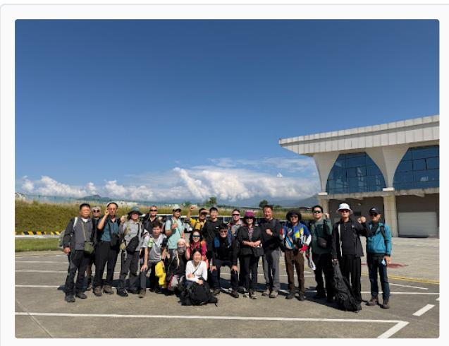

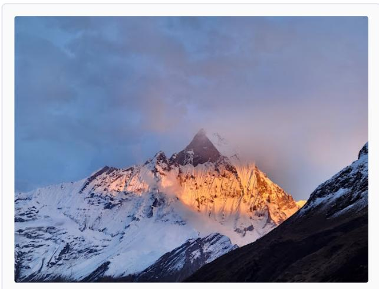

## 푼힐 파노라마 전망대 (3,210m)

3,210m 고지의 푼힐 전망대에 올라 웅장한 히말라야 산맥을 배경으로 단체 현수막을 들고 기념 촬영을 했 습니다. 일출과 함께 빛나던 파노라마 뷰는 잊지 못할 장관이었습니다.

마차푸차레의 여명 (Machapuchare)

'물고기 꼬리'를 닮아 신성시되는 마차푸차레 봉우리 가 아침 햇살을 받아 황금빛과 붉은빛으로 물드는 기 적 같은 순간. 대자연이 선물한 감동의 순간이었습니 다.

## 제3장: 정상을 향하여 – ABC와 화합의 밤

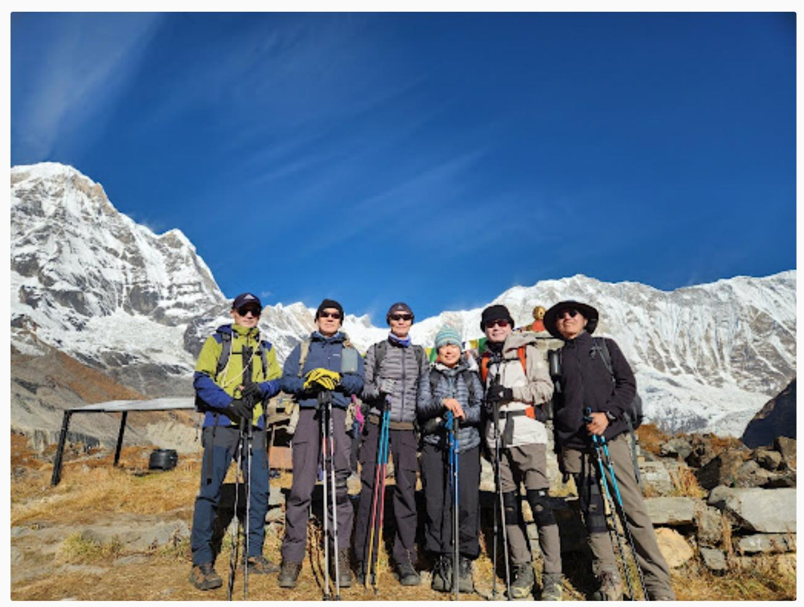

설산을 등지고 선 선봉대

눈으로 덮인 안나푸르나 산맥을 배경으로 트래킹 스틱을 짚고 선 대원들. 강렬한 맑은 하늘 아래 설산의 기운을 받으며 서로에 대한 신뢰와 우정을 다졌습니다.

H I M A L AYA N T R E K K I N G M E M O R I E S

# 안나푸르나의 빛과 바람을 따라서

�� 네팔 안나푸르나 (Annapurna Region) ��️ 히말라야 트래킹 포토북

CHAPTER 1. 신들의 정원, 그 장엄한 마주함

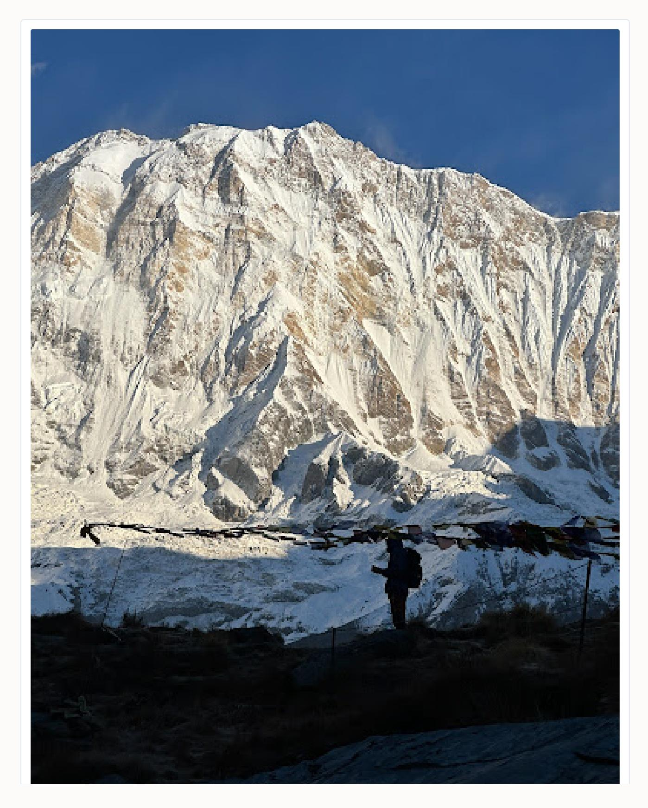

## CHAPTER 2. 붉은 여명, 희망을 밝히는 히말라야

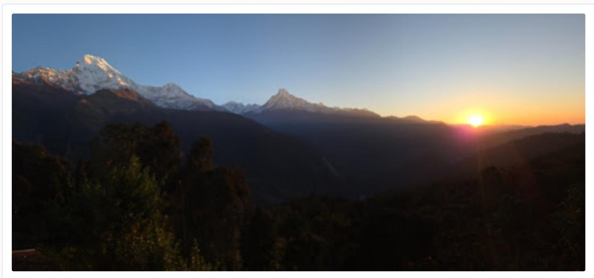

## 산맥 너머로 터져 나오는 일출의 환희 PANORAMIC VIEW

어둠을 헤치고 떠오르는 태양이 안나푸르나 산맥 전체를 따스하게 감싸 안는 순간. 차가운 새벽 공기 속에서 느껴지는 태 양의 훈기는 감동 그 자체였습니다.

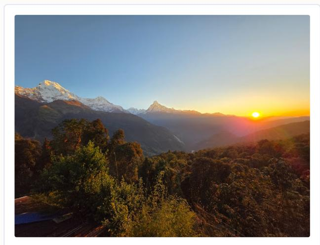

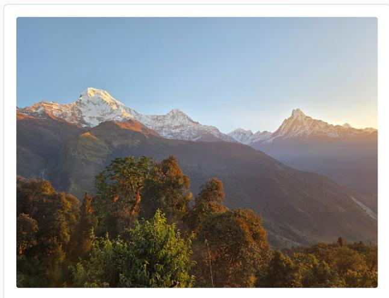

황금빛 사면과 숲 MORNING LIGHT

아침 햇살이 산자락과 우거진 숲을 붉게 물들이며 생명 력을 불어넣는 풍경입니다.

빛의 스펙트럼 SUNBURST

강렬한 일사광선이 수평선 위로 번지며 만들어내는 아름 다운 빛의 조화.

## CHAPTER 3. 고요함 속의 웅장함, 설산의 다양한 얼굴

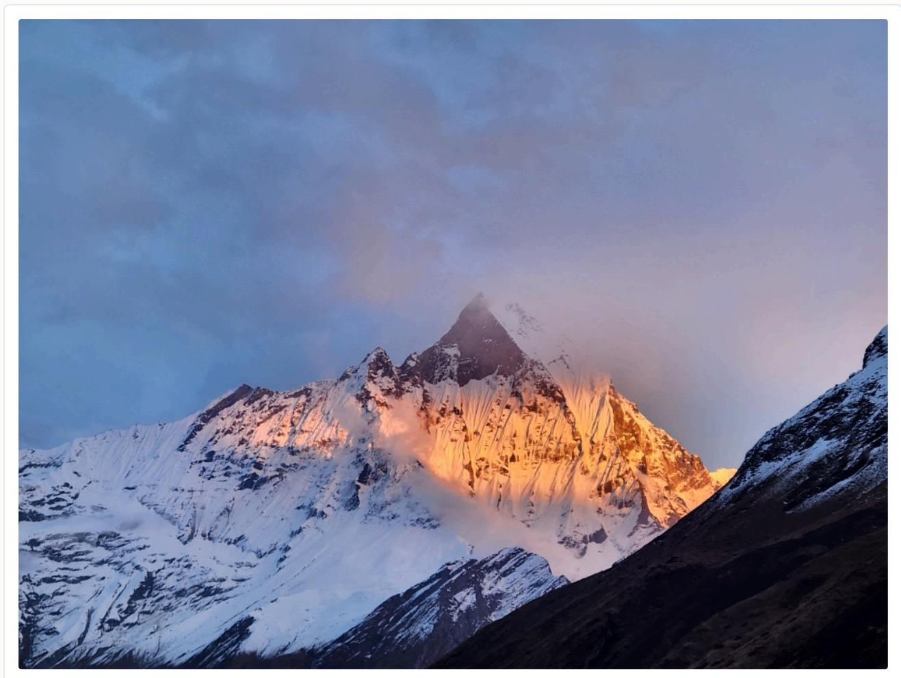

## 노을빛 붉은 물결이 지난 자리 AFTERGLOW

상부 캠퍼에서 바라본 마차푸차레의 측면. 깎아지른 절벽에 얹힌 눈과 붉은 잔영이 대비를 이루며 설산의 고결함을 더해 줍니다.

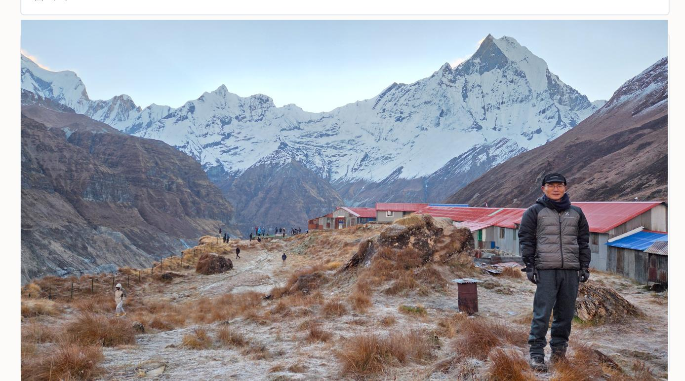

## CHAPTER 4. 산길 위에서 나눈 정과 휴식

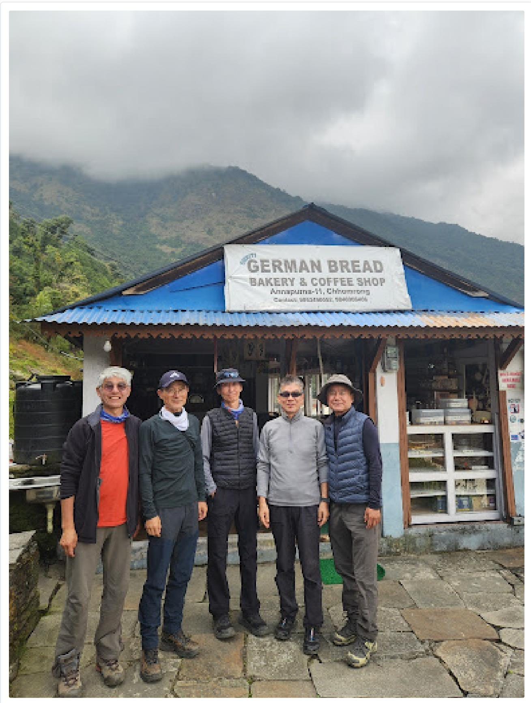

## CHAPTER 5. 도전의 결실, 영광스러운 완주

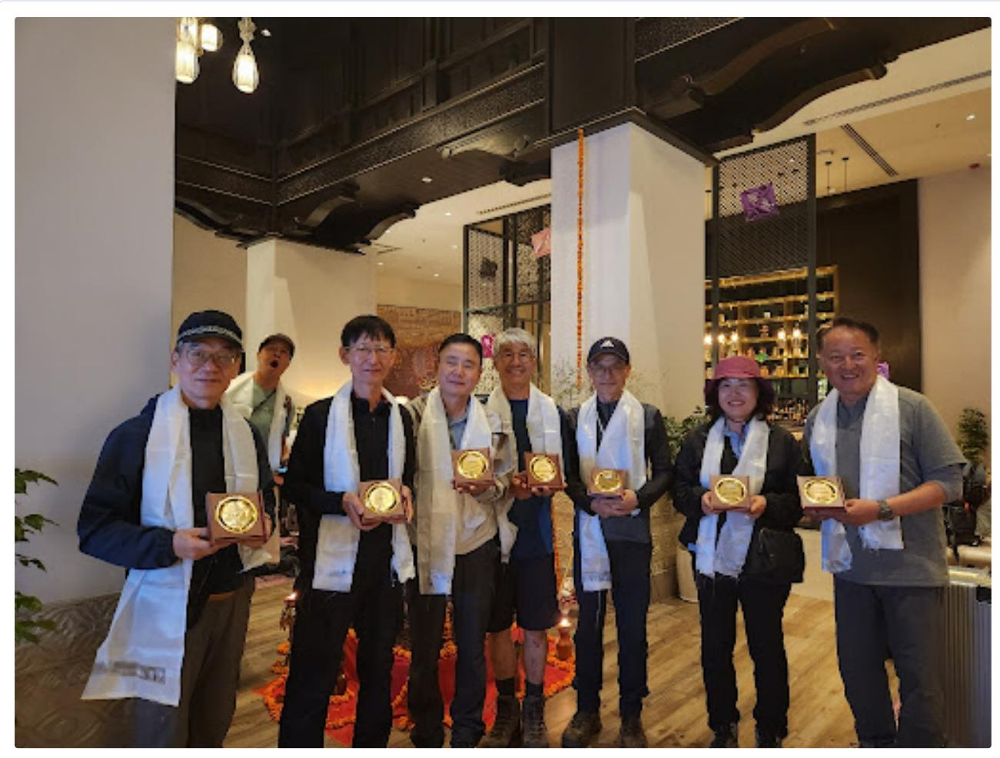

## 빛나는 트래킹 완주 기념 패 수여식 SUCCESS & CEREMONY

네팔의 전통 스카프 '카타(Khata)'를 목에 걸고 완주 기념 패를 손에 든 대원들의 자랑스러운 모습! 무사히 산행을 마치고 서로의 도전을 축하하는 기쁨과 감동의 순간입니다.

# 안나푸르나, 일출에 물들다

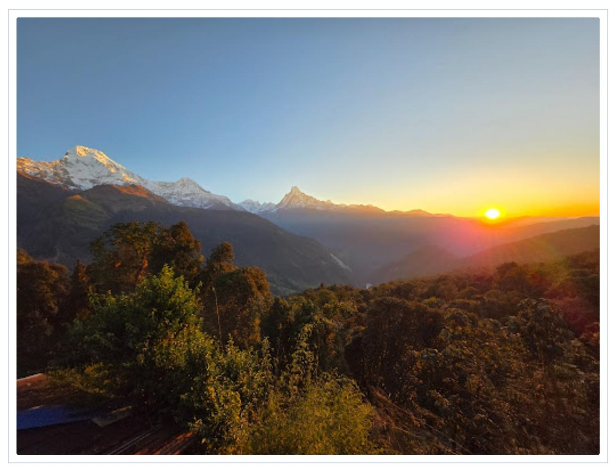

## 황금빛으로 깨어나는 설산의 아침 ANNAPURNA SUNRISE

어둠을 뚫고 지평선 너머로 솟아오른 태양이 안나푸르나 산맥을 황금빛으로 물들이는 순간입니다. 붉게 물든 능 선과 초목이 어우러져 한 폭의 유채화 같은 풍경을 선사합니다.

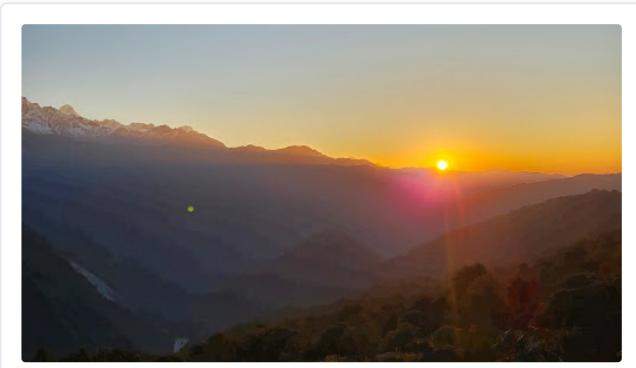

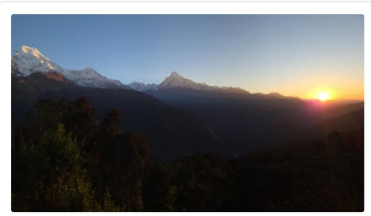

태양과 마주한 설봉

산선 능선 사이로 강렬한 햇살이 퍼지며 히말라야의 아침을 밝 힙니다. 고요함 속에 울려 퍼지는 자연의 감동을 느낍니다.

빛의 파도가 넘실거리는 산맥

산과 구름 레이어 사이로 번지는 핑크빛과 황금빛 빛내림이 트 래킹의 고단함을 깨끗이 씻어내어 줍니다.

## 하늘을 찌르는 신성의 봉우리

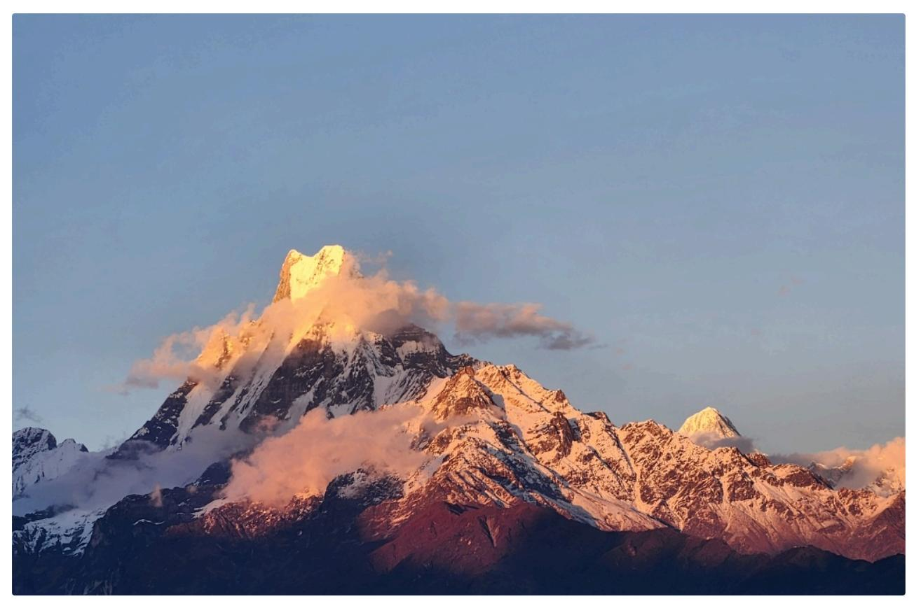

마차푸차레(Machapuchare)의 모닝 글로리 ALTITUDE 6,993M

'물고기의 꼬리'를 닮아 마차푸차레라 불리는 네팔의 성산. 아침 햇살을 받아 붉게 타오르는 마차푸차레의 날카로 운 봉우리와 주위를 감싸 안은 구름이 신비로운 분위기를 자아냅니다.

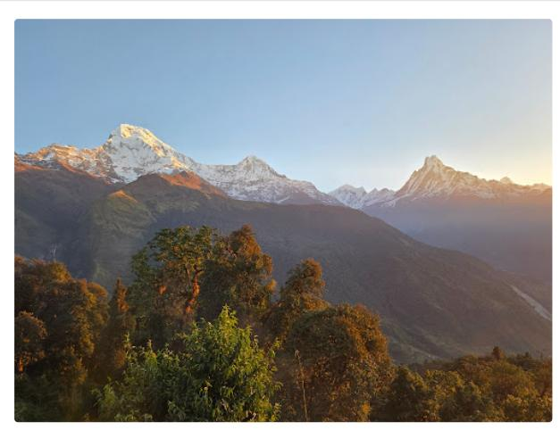

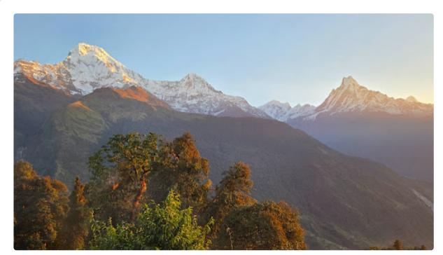

푸른 하늘과 울창한 숲

햇살이 완전히 떠오른 후 드러난 웅장한 안나푸르나 산맥. 아래 로는 울창한 상록수림이 든든하게 받쳐줍니다.

선명해진 선형과 골짜기

시간이 지남에 따라 점차 또렷해지는 만년설의 윤곽. 발걸음을 멈추고 넋을 놓고 바라보게 되는 순간입니다.

## 함께 걸어온 길, 완주의 기쁨

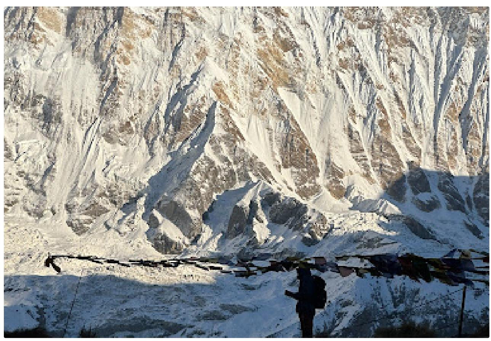

안나푸르나 거대한 암벽 아래에서 ANNAPURNA BASE CAMP

수직으로 치솟은 웅장한 설산 암벽과 타르초(오색 깃발)가 바람에 날리는 안나푸르나 베이스캠프 현장. 대자연의 압도적인 위용 앞에서 서서 느껴지는 감동은 평생 잊지 못할 순간입니다.

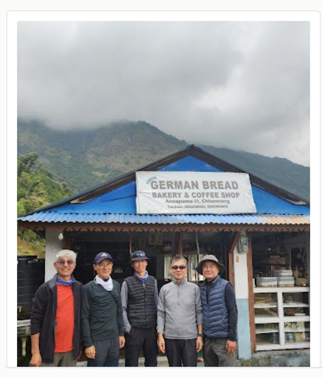

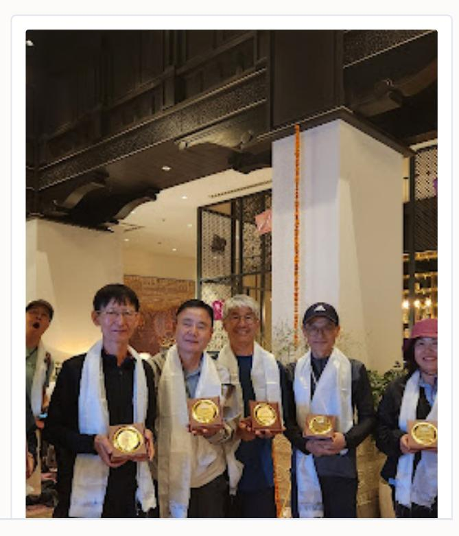

# 지누단다 현수교

Jhinu Danda Suspension Bridge · 안나푸르나 트레킹 주요 명소

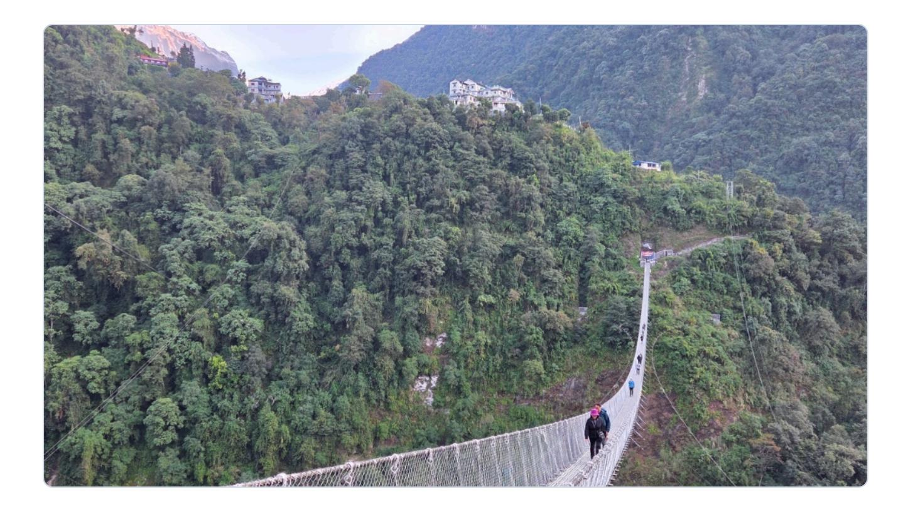

지누단다 현수교(Jhinu Danda Suspension Bridge)는 다리 길이 약 287m, 높이 약 135m에 달하며, 다리 너머 언덕 위로 보이는 마을이 바로 자연 노천 온천으로 유명한 지누단다(Jhinu Danda) 마을입니다.

다리 총 길이

약 287 m

계곡 높이

약 135 m

# 안나푸르나 트레킹: 히말라야 로지 숙소의 밤

고산 속 아늑한 산장(Lodge)에서의 휴식과 여정의 기록

숙소 풍경 요약: 히말라야 트레킹 중 머무는 로지(Lodge)는 대원들에게 포근한 쉼터가 되어줍니다. 침낭 속에서 추위를 이겨내며 휴식을 취하고, 다음 날의 여정을 위해 장비를 점검하는 동료들의 모습에서 깊은 동지애와 여유를 느낄 수 있 습니다.

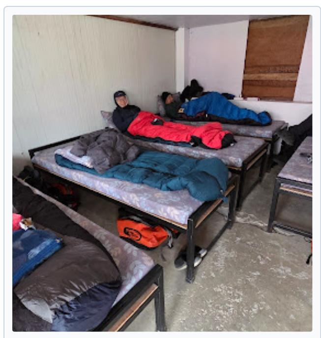

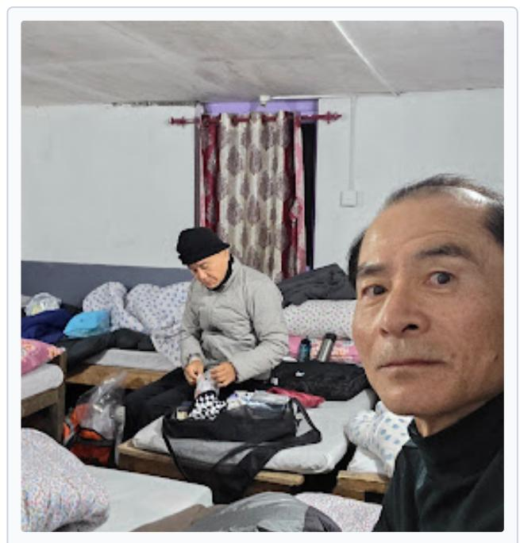

아늑한 산장 침실 풍경

여러 개의 침대와 따뜻한 침낭, 그리고 개인 배낭들이 나란히 놓여 있는 산장 내부의 모습

여유로운 휴식과 정비

숙소 안에서 포즈를 취하며 추억을 남기는 대원과 장비를 차분 히 정리하는 동료의 모습

# 안나푸르나 트레킹 포토 앨범 (1/2)

히말라야의 대자연 속에서 펼쳐지는 여정과 동행의 순간들

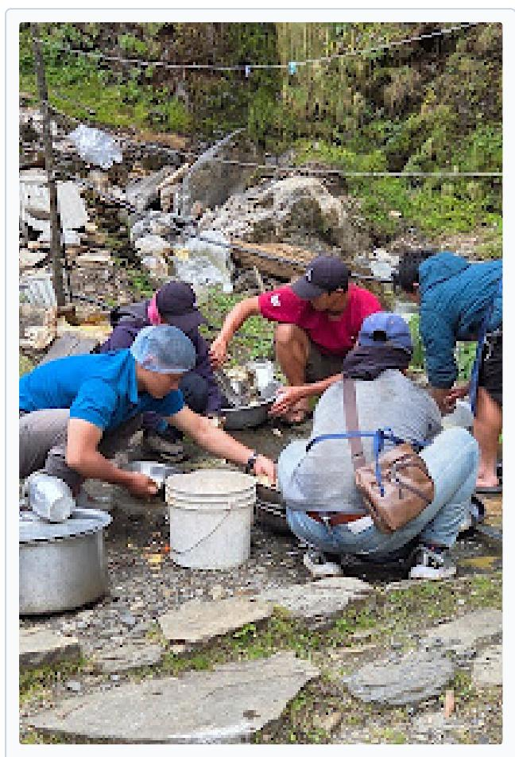

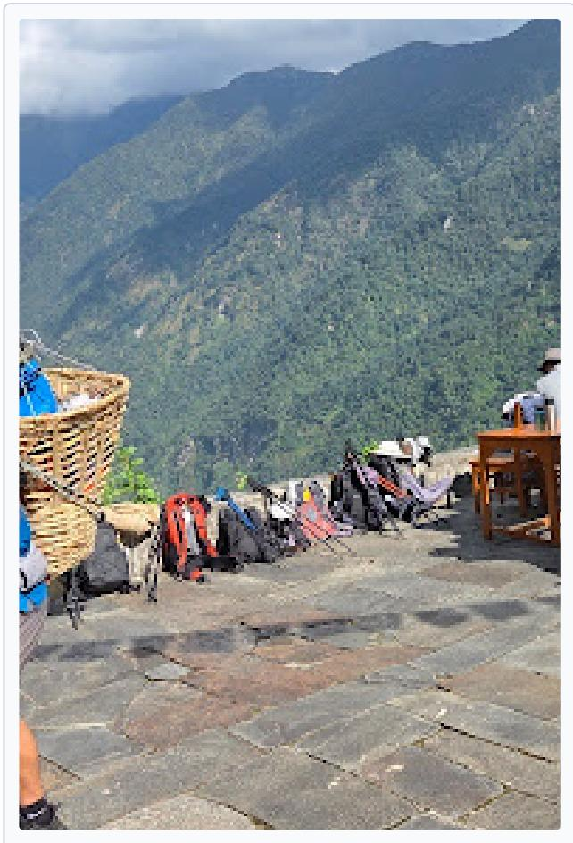

계곡에서의 취사 준비

흐르는 계곡물 옆에서 정성껏 식사를 준비하는 대원들과 포터 들의 분주한 손길

험난한 길을 걷는 포터들

거대한 짐을 전통 바구니에 메고 숨막히는 대자연 속을 묵묵히 나아가는 모습

# 안나푸르나 트레킹 포토 앨범 (2/2)

따뜻한 만찬과 깊어가는 우정

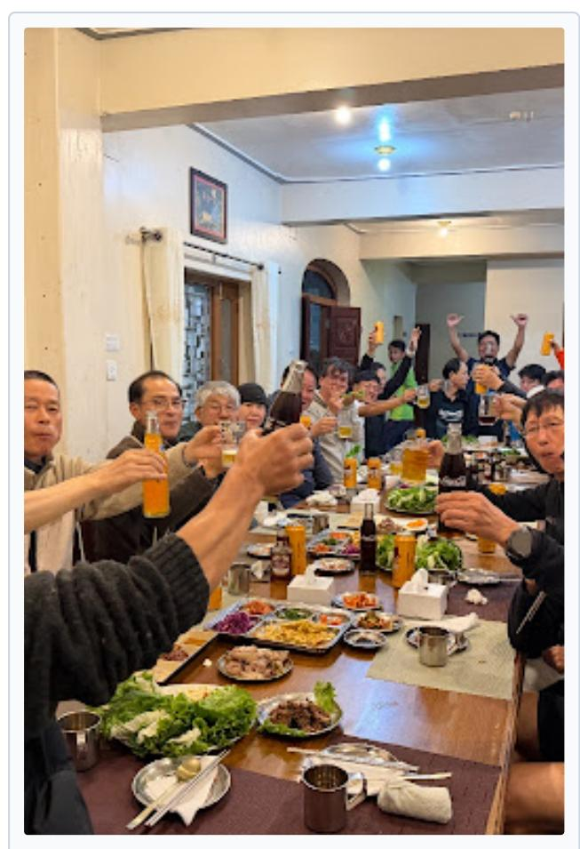

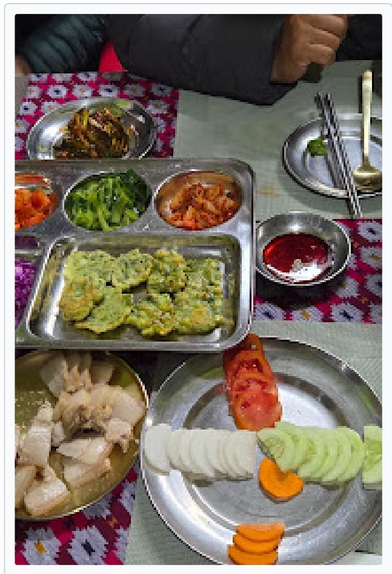

산장에서의 즐거운 건배

고된 산행 끝에 따뜻한 산장 모여 서로를 격려하며 나누는 축배 와 웃음소리

히말라야 속 한국의 맛

이국땅 산장에서 즐기는 수육과 신선한 채소 쌈, 피로를 녹이는 특별한 식사

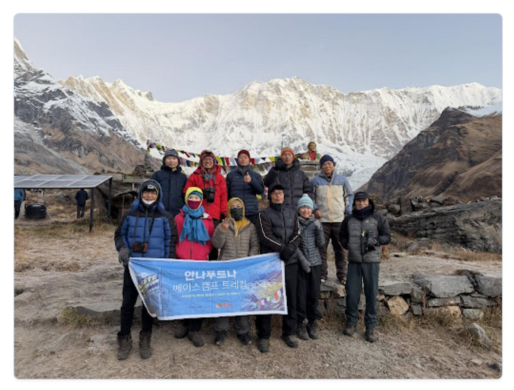

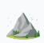

Global Travel Route: Incheon (ICN) ➔ Kathmandu (KTM) ➔ Pokhara ➔ Annapurna Circuit & ABC

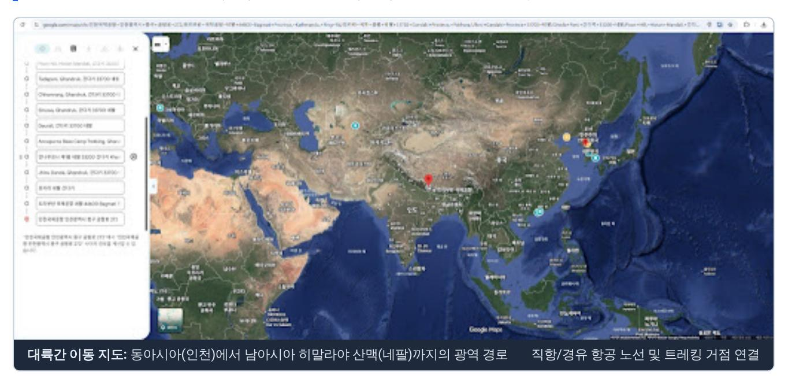

## ✈️ 국제선 및 네팔 국내 이동

인천국제공항 (ICN): 여정의 출발지로 직항(대한항공 등) 또는 경유편(방콕/구앙저우 등)을 이용합니다. 트리부반 국제공항 (KTM): 네팔 카트만두 소재의 국 제 관문으로 입국 비자(On-Arrival Visa)를 발급받습니 다. 포카라 (Pokhara): 국내선 항공(약 25분) 또는 차량 이 동을 통해 도달하는 안나푸르나 트레킹의 전초기지입 니다.

### �� 히말라야 산악 트레킹 세부 경로

체크포인트 목록: 푼힐(Poon Hill) ➔ 타다파니 ➔ 촘롱 ➔ 시누와 ➔ 데우랄리 ➔ ABC ➔ 지누단다 산악 지형: 포카라에서 산악 지프 차량으로 이동 후 도 보 트레킹이 시작됩니다. 다양한 코스 연계: 푼힐 일출 전망대 코스 및 ABC(안나 푸르나 베이스캠프) 원형 분지를 순환하는 코스입니 다.

| 출발 지점           |         |                             |
|-----------------|---------|-----------------------------|
| 인천국제공항 (Incheon | Int'l   |                             |
| Airport, ICN)   |         |                             |
|                 |         | 국제선 항공시간                    |
|                 |         | 직항 기준 약 7시간~8시간 소요 (대       |
|                 |         | 한항공 운항)                     |
| 네팔 현지 이동        |         |                             |
| 카트만두 ➔ 포카라      | (국내선 25 |                             |
| 분 / 차량 6~8시간) ➔ | 마트큐/나   |                             |
| 야풀 (지프 3시간)     |         |                             |
|                 |         | 트레킹 주요 거점                   |
|                 |         | Chhomrong, Sinuwa, Deurali, |
|                 |         | Annapurna Base Camp (ABC:   |
|                 |         | 4,130m), Jhinu Danda        |

�� 원거리 이동 & 트레킹 준비 팁: 카트만두 도착 후 TIMS(트레커 정보 관리 시스템) 및 ACAP(안나푸르나 보존지역 허가서)를 발 급받아야 합니다. 포카라에서 트레킹 장비 점검을 마친 뒤 산악 지프편으로 이동하며, 고고도 구간(3,000m 이상)에서는 고산병 예 방을 위한 신체 적응 일정을 반드시 포함하는 것이 좋습니다.

Ghorepani to Poon Hill Sunrise Trek - Satellite Map & Route Analysis

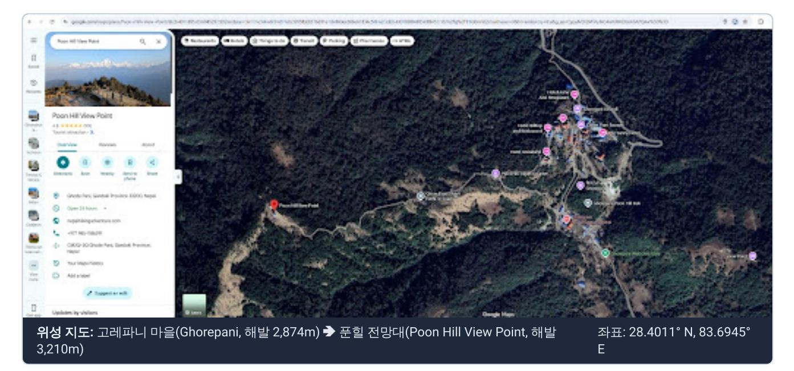

### �� 주요 지점 위치 안내

고레파니 마을 (우측 상단): 숙소, 로지, 레스토랑 및 병 원(Community Hospital)이 밀집한 베이스캠프 마을입 니다. 티켓 매표소 (중앙 우측): 마을에서 푼힐 방면 오르막 진입로에 입산 티켓 창구(Poon Hill Ticket Counter)가 위치합니다. 푼힐 전망대 (좌측 핀 위치): 능선 끝에 위치한 최종 목 적지로 일출 감상 및 안나푸르나·다울라기리 산맥 조 망 포인트입니다.

## 등산 경로 및 지형 특징

등산로 형태: 고레파니 마을에서 시작하여 서쪽 능선 을 따라 완만하게 구불구불 이어지는 돌계단 코스입니 다. 거리 및 소요시간: 편도 약 1.5km, 고도차 약 336m를 오르며 완만한 걸음으로 약 45분~1시간 소요됩니다. 지형 요소: 초반부 숲길을 지나 능선부 진입 시 탁 트인 시야 확보, 우측 하단에는 웰컴 게이트가 위치합니다.

| 목적지 정보    |                           |
|-----------|---------------------------|
| Poon      | Hill View Point (네팔 간다    |
| 키주 고레파니)  | 추천 출발 시간                  |
|           | 새벽 04:30 ~ 05:00 (일출 시간 고 |
| 준비물 & 장비  |                           |
| 헤드랜턴(필수), | 방한의류(다운패                  |
| 딩, 장갑),   | 핫팩, 티켓용 현금                |
| (NPR),    | 생수                        |
|           | 조망 가능 봉우리                 |
|           | 다울라기리(8,167m), 안나푸르나 1    |
|           | 봉(8,091m), 마차푸차레(6,993m)  |

�� 일출 트레킹 핵심 팁: 새벽 출발 시 온도가 영하권으로 떨어지므로 레이어드 방한복 착용이 필수입니다. 매표소에서 입산료 지불 을 위해 소액의 네팔 루피 현금을 미리 준비하시고, 카메라 및 휴대폰은 추위에 배터리가 방전되지 않도록 핫팩과 함께 보관하세요.

ABC Trek Start at Matkiu & Jhinu Danda Area - Route Breakdown

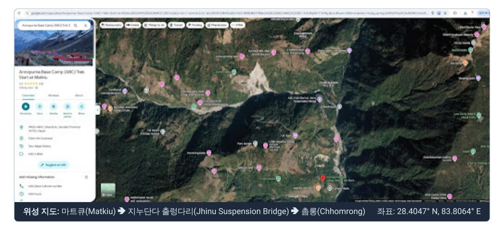

## �� 주요 거점 및 거점 설명

마트큐 (Matkiu, 하단 붉은 핀): 포카라에서 지프 차량 으로 이동할 수 있는 최신 트레킹 지상 시작점입니다. 지누단다 출렁다리 (Jhinu Suspension Bridge): 협곡 을 연결하는 네팔 최고 수준의 긴 현수교로, 지누단다 접근성을 획기적으로 높였습니다. 지누단다 (Jhinu Danda): 온천(Hot Spring)으로 유명 한 마을로, 하산 시 피로를 풀기 위해 들르는 필수 거점 입니다. 촘롱 (Chhomrong, 상단 마을): ABC로 들어가는 관문 마을로, 급경사 계단 구간 후 만나는 안나푸르나 전경 이 뛰어납니다.

## �� 경로 특징 및 지형 분석

차량 이동 ➔ 트레킹 전환: 포카라에서 나야풀/간드룩 거쳐 마트큐까지 지프로 이동 후 도보 트레킹을 시작 합니다. 지누단다 ➔ 촘롱 구간: 악명 높은 돌계단 오르막 구간 (약 2,000여 개 계단)이 시작되는 코스입니다. 동선 효율성: 과거 나야풀에서 시작하던 방식에 비해 마트큐 출발 시 약 1~2일의 이동 시간을 단축할 수 있 습니다.

| 시작 지점명   |             |                       |
|----------|-------------|-----------------------|
| Matkiu   | (ABC        | Trek Start Point) /   |
| Ghandruk | Rural       | Municipality          |
|          |             | 포카라 ➔ 마트큐 이동          |
|          |             | 지프(Jeep) 차량 이용 시 약 3시 |
|          |             | 간 ~ 3시간 30분 소요        |
| 주요 통과 경로 |             |                       |
|          | 마트큐(Matkiu) | ➔ 지누단다(Jhinu          |
| Danda)   | ➔           | 촘롱(Chhomrong) ➔ 시     |
|          |             | 핵심 관전 포인트             |
|          |             | 지누단다 노천 온천, 촘롱 안나푸    |
|          |             | 르나/남봉 뷰, 거대 현수교       |
|          |             | (Suspension Bridge)   |

�� 트레커를 위한 실전 팁: 마트큐에서 출발하여 지누단다 현수교를 건너면 곧바로 촘롱으로 향하는 가파른 오르막이 시작됩니다. 촘롱에서 필요한 생필품 및 대피소 정보(TIMS/허가증 확인)를 재점검하시기 바라며, 하산 길에는 지누단다 온천에 들러 피로를 푸 는 일정을 추천합니다.

Annapurna Base Camp Trekking (4,130m) - Satellite Map & Sanctuary Route Guide

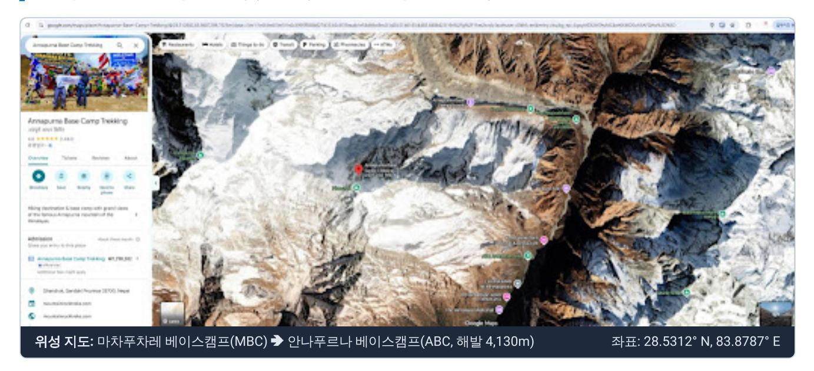

## �� 주요 지점 및 기지 안내

안나푸르나 베이스캠프 (중앙 붉은 핀): 해발 4,130m 에 위치한 최종 목적지이며, 거대한 설산 빙하와 봉우 리들에 둘러싸인 '안나푸르나 상추어리(Sanctuary)'입 니다. 마차푸차레 베이스캠프 (MBC, 우측 상단): 해발 3,700m에 위치한 주요 전초기지이며, ABC 진입 전 필 수 정류장입니다. 하단 계곡 코스 (우측 하단): 데우랄리(Deurali), 히말라 야(Himalaya) 등 모디 콜라(Modi Khola) 협곡을 따라 오르는 등산로입니다.

### ��️ 지형적 특징 및 루트 특징

MBC ➔ ABC 코스: 우측 상단의 MBC에서 시작하여 완만한 빙하 U자곡 계곡을 따라 좌측 상단의 ABC로 이동하는 약 2시간 코스입니다. 설산 파노라마: ABC 도달 시 안나푸르나 1봉(8,091m), 안나푸르나 남봉, 마차푸차레, 갠가푸르나 등 360도 설산 병풍이 펼쳐집니다. 고산 지형: 수목 한계선을 지나 풀과 바위, 눈으로 이루 어진 고산 지대이며 급격한 고도 상승 구간입니다.

| 목적지 정보                      |    |                          |
|-----------------------------|----|--------------------------|
| Annapurna Base Camp (ABC, 네 |    |                          |
| 팔 간다키주 고드룩)                 |    |                          |
| MBC                         | ➔  | ABC 소요시간                 |
|                             |    | 약 1.5 ~ 2시간 (거리 약 3.5km, |
|                             |    | 고도차 +430m)               |
| 준비물 & 장비                    |    |                          |
| 방한 고어텍스 재킷, 다운 패딩, 아        |    |                          |
| 이젠, 스틱, 보온병, 고산병 약(다이       |    |                          |
| 조망                          | 가능 | 봉우리                      |
|                             |    | 안나푸르나 1봉(8,091m), 안나푸    |
|                             |    | 르나 남봉(7,219m), 마차푸차레     |

⚠️ 고산병 및 위험 구간 유의사항: 데우랄리~MBC 구간은 봄철 낙석 및 겨울철 눈사태(Avalanche Danger Zone) 위험이 있으므로 주의가 필요합니다. MBC에서 ABC로 향할 때는 수분 섭취를 충분히 하고 천천히 보행하여 고산병을 예방하세요.

Annapurna I (8,091m) & ABC Sanctuary Area Topographical Satellite Map

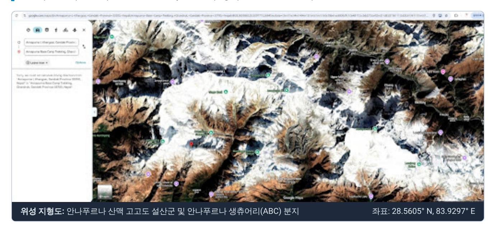

## ��️ 주요 고봉 및 거점 위치

안나푸르나 1봉 (Annapurna I, 8,091m): 분지 북쪽에 병풍처럼 솟아 있는 세계 제10위 고봉입니다. 안나푸르나 베이스캠프 (ABC, 붉은 핀): 고봉들로 둘 러싸인 거대한 원형 빙하 분지(Sanctuary) 중앙에 위 치합니다. 마차푸차레 (Machhapuchhre, 6,993m): 분지 입구 동 쪽에 위치한 여신 성산으로, MBC(마차푸차레 베이스 캠프)가 거점이 됩니다. 강가푸르나 (Gangapurna, 7,455m): 안나푸르나 1봉 동쪽에 위치한 웅장한 백색 설산입니다.

### �� 지형 구조 및 원형 분지 분석

산앙(Sanctuary) 지형: 7,000~8,000m급 설산 봉우리 들이 360도로 거대 원형 성벽을 이루는 독특한 천혜의 분지 구조입니다. 빙하 및 협곡 지대: 안나푸르나 남벽에서 시작되어 모 디 콜라 계곡으로 이어지는 빙하천 및 급경사 지형이 발달했습니다. 접근성 특징: 도로 연결이 불가능한 고고도 보행 트레 킹 전용 구간으로, 기상 변화에 주의가 필요합니다.

| 최고봉 및 고도  |            |                             |
|-----------|------------|-----------------------------|
| Annapurna | I (8,091m) | / ABC 표고 약                  |
|           |            | 지형적 분류                      |
|           |            | Himalayan Sanctuary Glacial |
|           |            | Basin (빙하 원형 분지)            |
| 주요 인근 봉우리 |            |                             |
| Annapurna | South      | (7,219m),                   |
| Hiunchuli | (6,441m),  | Machhapuchhre               |
|           |            | 기후 및 환경                     |
|           |            | 고산 기후, 강한 주간 일조량 및          |
|           |            | 야간 급격한 기온 하강 (고산병           |

�� 고고도 탐방 가이드: ABC 분지는 고도 4,130m에 위치하므로 고산병 예방을 위해 충분한 수분 섭취와 천천히 오르는 일정 관리 가 필수적입니다. 일출 직후 안나푸르나 1봉 남벽에 붉은 햇살이 비치는 황금빛 설산 풍경이 대표적인 관전 포인트입니다.

Annapurna Region Natural Thermal Springs - Location & Relaxation Guide

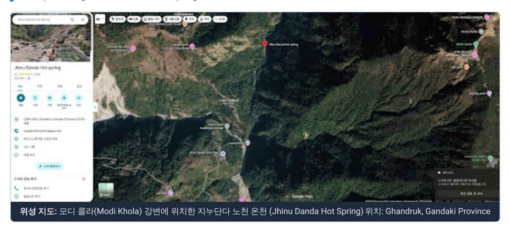

## ♨️ 주요 지점 및 온천 위치

노천 온천 (상단 붉은 핀): 모디 콜라(Modi Khola) 계곡 강변 바위지대에 위치한 천연 노천 온천입니다. 지누단다 마을 (Jhinu Danda): 지도 중앙 산등성이에 위치하며 롯지, 식당, 현수교 접근로가 모여 있습니다. 지누단다 현수교 (Jhinu Suspension Bridge): 하단에 위치한 긴 현수교로, 지프 정류장(Jeep Stand) 및 마트 큐 방향 연결선입니다.

### 접근 경로 및 지형 특징

마을 ➔ 온천 이동: 지누단다 롯지촌에서 계곡 아래 강 변까지 내리막 돌계단을 약 20~25분 내려갑니다. (복 귀 시 약 30~35분 오르막) 자연 욕조 구성: 모디 강 줄기 바로 옆에 돌로 쌓은 3개 의 노천탕이 마련되어 있으며 약 35~40℃의 미지근하 고 따뜻한 온천수가 흐릅니다. 하산 필수 코스: ABC 트레킹 완료 후 하산길에 피로와 근육통을 풀기 위해 트레커들이 가장 선호하는 휴식처 입니다.

| Jhinu Danda Hot Spring (지 |    |                            |
|---------------------------|----|----------------------------|
| 누단다 노천 온천)                |    |                            |
| 입장료                       | /  | 이용 시간                      |
|                           |    | 약 100~150 NPR (유지관리비) / 일몰 |
|                           |    | 전까지 이용 가능                  |
| 필수 준비물                    |    |                            |
| 수영복 또는 젖어도 되는 옷,          |    |                            |
| 타월, 슬리퍼, 물통               |    |                            |
| 편의                        | 시설 |                            |
|                           |    | 탈의실 및 탈의용 라커 보유, 강변 인근     |
|                           |    | 간단한 음료 판매대                 |

�� 이용 팁 & 에티켓: 온천탕 입수 시에는 수영복 착용이 필수입니다. 계곡 강변에 위치하므로 일몰 후에는 비탈길이 어두워져 위험 할 수 있으니 헤드랜턴을 챙기거나 밝을 때 다녀오시는 것을 권장합니다. 하산하는 날 일정에 온천욕 시간을 1~2시간 포함하면 피 로 회복에 매우 효과적입니다.

## ��️ 안나푸르나·푼힐 트레킹 최고 난이도 코스 및 핵심 유의사항

고라파니 오르막 및 데우랄리 ➔ MBC ➔ ABC 구간 지형 분석 및 안전 가이드

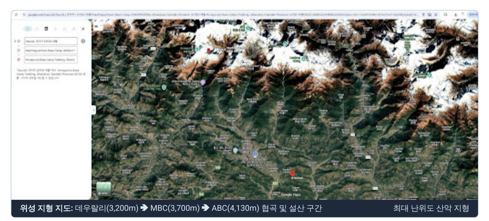

## 1. 가장 힘든 대표 구간

## �� 고라파니 오르막 구간 (3일 차)

#### 포카라 ➔ 나야폴 ➔ 고라파니

거리 및 고도: 약 12.3km, 고도 약 1,000m 이상 상승 특징: 울레리를 거쳐 고라파니로 올라가는 이 구간은 끝없이 이 어진 돌계단 오르막으로 악명이 높습니다. 트레킹 초반임에도 불구하고 단시간에 급격히 고도를 높여야 하기 때문에 체력 소 모가 매우 큽니다.

## �� 베이스캠프 최종 진입 구간 (6~7일 차)

데우랄리(3,200m) ➔ MBC(3,700m) ➔ ABC(4,130m)

코스 세부: 데우랄리(3,200m) ➔ MBC (마차푸차레 베이스캠 프, 3,700m) ➔ ABC (안나푸르나 베이스캠프, 4,130m) 거리 및 고도: 해발 3,200m에서 최종 목적지인 4,130m까지 점 진적 상승

특징: 본격적인 고산 지대에 진입하는 핵심 하이라이트이자 최 대 난관 구간입니다. 고도가 높아질수록 산소가 희박해져 발걸 음이 무거워지고 호흡이 급격히 가빠집니다.

## 2. 무엇이 가장 힘이 드는가? (핵심 요인 3가지)

## 1. 희박한 산소와 고산증 (고도 부담)

해발 3,000m(데우랄리 이후)를 넘어서면서부터 공기 중 산소량이 급격히 감소합니다. 이로 인해 두통, 어지러움, 호흡곤란 등 고산증 세가 발생할 수 있으며, 심장과 폐의 부담이 극대화됩니다.

### 2. 끝없는 돌계단과 가파른 경사

히말라야 트레일 특성상 완만한 흙길보다는 수천 개의 가파른 돌계단 지형이 많아 무릎, 관절, 허벅지 근육에 엄청난 하중과 피로가 누적됩니다.

## 3. 극한의 추위와 환경적 제약

최종 목적지인 ABC(안나푸르나 베이스캠프, 4,130m) 및 MBC(마차푸차레 베이스캠프, 3,700m) 등 고산 지역으로 갈수록 밤낮 기온 이 영하로 떨어져 극심한 추위와 싸워야 합니다. 또한 체력 회복이 절실한 고산 구간에서는 고산증 유발 방지를 위해 샤워·머리감기 가 엄격히 금지되며, 협소한 다인실 롯지를 이용해야 하므로 누적 피로를 해소하는 데 어려움이 있습니다.

# 풍요의 여신, 안나푸르나

## Annapurna I · 8,091m · Nepal Himalayas

#### 해발 고도

8,091 m (세계 제10봉)

#### 위치

네팔 중부 히말라야 산맥

산맥 / 산군

안나푸르나 히말 (Annapurna Massif)

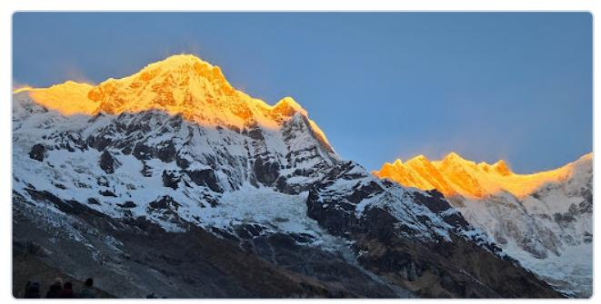

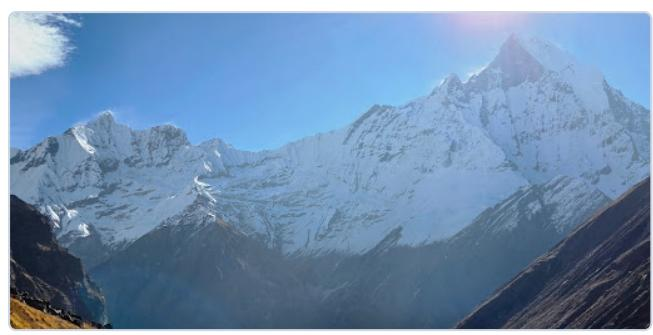

#### 최초 등정

1950년 6월 3일 (모리스 에르조그 & 루이 라슈날)

맑은 하늘 아래 우뚝 솟은 안나푸르나 산군과 마차푸차레 황금빛 일출에 물드는 안나푸르나 베이스캠프(ABC)의 설산

## 개요 및 산명의 유래

안나푸르나(Annapurna)는 네팔 중부 히말라야산맥에 위치한 거대한 산군으로, 주봉인 안나푸르나 I봉은 해발 8,091m로 세계에서 10번째로 높은 산입니다. 산 이름은 산스크리트어로 '결실의 여신' 또는 '풍요의 여신'이라는 의 미를 지니고 있습니다.

## 등반사적 의의 및 특징

최초의 8,000m급 등정: 1950년 프랑스 등반대에 의해 인류가 최초로 등정한 8,000m 이상의 고봉으로, 산악 역사 에 한 획을 그은 곳입니다. 험준한 난이도: 가파른 남벽과 빈번한 눈사태로 인해 8,000m급 고봉 중에서도 가장 위험하고 등반 성공률이 낮은 난공불락의 산으로 꼽힙니다. 세계적인 트레킹 코스: 안나푸르나 산군을 한 바퀴 도는 라운드 트레킹과 베이스캠프(ABC) 트레킹은 다채로운 자 연경관으로 세계 트레커들에게 가장 사랑받는 코스입니다.

## 주요 봉우리 구성

안나푸르나 산군에는 제1봉(8,091m) 외에도 제2봉(7,937m), 제3봉(7,555m), 제4봉(7,525m), 안나푸르나 남봉 (7,219m), 그리고 신성시되어 등반이 금지된 '물고기 꼬리' 형상의 마차푸차레(6,993m) 등이 병풍처럼 둘러서 있습 니다.

# 세계의 지붕, 에베레스트산

## Mount Everest · Sagarmatha · Chomolungma

#### 해발 고도

8,848.86 m (세계 최고봉)

위치 네팔 - 중국(티베트) 국경 최초 등정 1953년 5월 29일 (힐러리 & 텐징)

산맥 히말라야산맥 (마할랑구르)

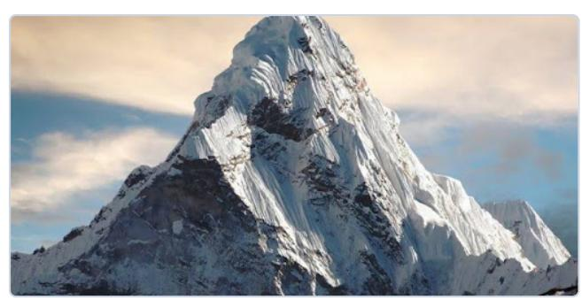

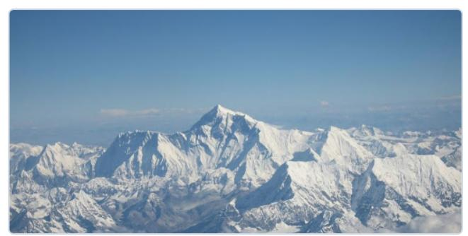

웅장하게 솟아오른 에베레스트 정상부 항공에서 바라본 히말라야 산맥과 에베레스트

## 개요 및 특징

에베레스트산은 지구상에서 가장 높은 산으로, 히말라야산맥의 중심으로 꼽힙니다. 지각 판 구조 운동에 따라 인도 판이 아시아 판 밑으로 계속 밀려 들어가면서 지금도 매년 약 4mm씩 고도가 상승하고 있습니다.

## 명칭의 유래

에베레스트 (Everest): 영국의 인도 측량국장이었던 조지 에베레스트(Sir George Everest) 경의 이름을 따서 명명되 었습니다. 사가르마타 (Sagarmatha): 네팔어로 '하늘의 이마'를 의미하며, 네팔 정부에서 공식 명칭으로 사용합니다. 초모랑마 (Chomolungma): 티베트어로 '세계의 어머니(대지의 여신)'라는 뜻을 가지고 있습니다.

## 탐험과 등반

수많은 알피니스트들의 최종 목표이자 도전의 상징인 에베레스트는, 극심한 저기압과 희박한 산소, 예측할 수 없는 기상 변화로 인해 '죽음의 지대(Death Zone)'로도 불립니다. 그럼에도 불구하고 매년 세계 각국의 등반가들이 그 정 상을 향한 도전을 이어가고 있습니다.

## 안나푸루나 ABC 성과 분석 및 에베레스트 3-Passes 진단

대상: 서맥(43회/분) 및 부정맥 보유 트레커 최근 실적: 2026년 10월 ABC(4,130m) 완주

종합 종합 건강 & 체력 평가 결과 사전 의료 승인 + 철저한 행동 요법 실천 우수 (High Adaptability)

## 1. 안나푸루나 ABC 성공 요인 분석

### ① 스포츠 서맥의 심장 효율성

평소 서맥(43회/분)은 강한 심장 박출량(Stroke Volume) 을 의미할 수 있으며, 고지대 산소 부족 환경에서도 심박 수의 과도한 솟구침을 막아주어 심장 과부하를 예방함.

### ② 완벽한 고산 적응 행동 요법

전문 가이드의 극단적 저속 산행('비스따리')과 영양/수분 섭취(한식)를 충실히 이행하여 저산소 분압 적응 시간을 확보함 (고산병 약 미복용 상태 유지).

## 2. 수면 중 증상 분석: 고산성 주기적 호흡

## ABC(4,130m) 수면 중 일시적 호흡곤란 원인

발생 기전: 수면 중 저산소 반응(과호흡)으로 체내 CO₂가 급격히 배출되어, 뇌간이 일시적으로 호흡 명령을 중단(무호 흡)한 후 놀라 깨어나는 자연스러운 생리 반응. 대처 적절성: 깨어난 즉시 상체 일으키기, 수분 섭취, 의식적 심호흡(10회)을 통해 CO₂/산소 균형을 신속히 회복함. 환경 요인: 고성능 침낭으로 체온을 유지하여 교감신경 자극 및 심장 부담을 최소화함.

## 3. 차기 목표: 에베레스트 3-PASSES & 3-RI 가능성 진단

| 구분           | 안나푸루나 ABC (성공)     | 에베레스트 3-Passes & 3-Ri (도전 예정) |
|--------------|--------------------|-------------------------------|
| 최고 고도        | 4,130m             | 5,535m (공마라/초라/렌조라 패스)        |
| 4,000m 이상 체류 | 약 1~2일             | 약 10~12일 연속 체류                |
| 일일 산행 시간     | 5~7시간              | 8~10시간 이상 (고개 이동일)            |
| 환경적 리스크      | 산소 분압 ~62% (적응 가능) | 산소 분압 ~50% (수면 장애 극심)         |

## 4. 향후 안전 도전 전략 및 권고사항

중간 단계 검증: 3-Passes 전, 4,500~5,000m급(EBC 단독 또는 고쿄)에서 다일 체류 수면 반응 재확인. 심장내과 재검진: 출발 전 24시간 홀터 심전도 및 운동부하 검사를 통한 부정맥 유발 가능성 최신화. 비상 우회로 확보: 일일 일정에 여유일(Buffer day)을 두고, 컨디션 난조 시 패스를 넘지 않는 우회 경로 확보.